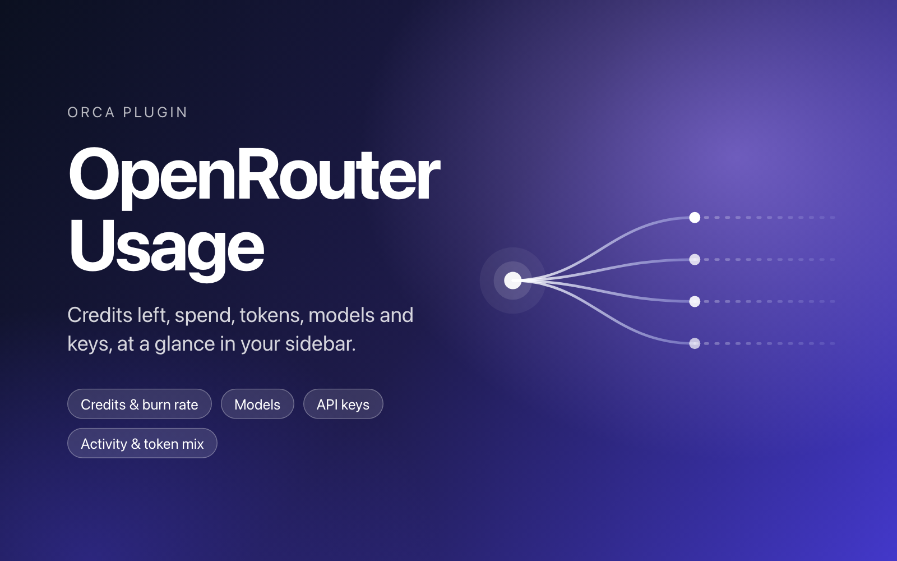

# OpenRouter Usage



A sidebar dashboard for [Orca](https://orca.dev) that shows what you spend on [OpenRouter](https://openrouter.ai): credits left, spend, tokens, models and API keys.

Requires Orca 1.4.248 or later and an OpenRouter **management key** (OpenRouter Settings, Management Keys).

## What it shows

- A banner with your **credits left**, how long they last at your recent burn rate, and an **Add credits** button, in the colour you choose.
- **Warnings** under the banner for credits running out, keys near or at their limit, expiring keys and a passed monthly budget. Each closes with an ×.
- Three tabs:
  - **Usage**: today and this month (with an optional monthly budget), a daily chart for 7 days, 30 days or all time in Cost or Tokens, your models, the token mix and a 26-week activity heatmap. Hover a bar to read its day; click a day, in the chart or the heatmap, to see its models and token mix. Click a model for its details.
  - **Keys**: spend per API key with its own 7D, 30D and All switch, limit meters, and badges only for keys that need attention.
  - **Settings**: verify, replace or disconnect your key, refresh interval, alerts, budgets, the status bar item, BYOK counting, and the banner's colour and vivid switch, with a live preview.
- **CSV exports** of daily totals, models or API keys from the ⋯ menu.
- A status bar item (`$25.20 left · $0.10 today`) and notifications when credits run low or a budget is passed.

## Install

```
orca plugin install Lilykos/orca-openrouter-usage
```

Orca shows what the plugin is allowed to do and asks you to approve it.

Existing marketplace installs update through Orca's marketplace after its catalog indexes the new release. Version 1.3.0 adds no capabilities, but Orca may ask you to review the new banner settings. Your key and settings stay with the existing install.

## Setup

Open the panel and paste your management key; it is verified with OpenRouter before it is saved. The key is stored in the plugin's encrypted secrets (OS keyring) and never leaves the worker process; the panel never sees it. The Settings tab has: connection test, replace or disconnect the key, refresh interval, low-balance alert, daily budget, notifications, status bar item, and whether BYOK usage counts in spend.

## Data and limits

All numbers come from OpenRouter's `/credits`, `/activity` and `/keys` endpoints; the plugin only ever sends `GET` requests.

- `/activity` covers the last 30 completed UTC days and excludes today. **Today** is computed from per-key totals, so it is approximate. Longer ranges build up from the day you install.
- Per-key spend is fetched separately with `/activity?api_key_hash=…`. Until that fetch succeeds, an unknown amount shows as a dash and exports as a blank cell.
- Comparisons need at least 14 days of history for 7d and 60 days for 30d; All has no comparison. Coverage is conservatively inferred from the earliest stored activity, so accounts with long idle periods may wait longer. Today is excluded from comparisons.
- BYOK follows the setting for spend and budgets. Credit runway always uses OpenRouter credit spend, excluding external BYOK inference costs.
- CSVs use the selected range and BYOK setting and always export USD spend, even in Tokens mode. Daily exports include approximate today; model exports cover completed days; All-time key exports include lifetime usage. UTC bounds and export time are included. Key hashes and the management key are omitted; formula-like names are prefixed with an apostrophe for spreadsheet safety.
- Monthly figures and today's totals are approximate: deleted keys or other workspaces may not be included in key totals. Budgets use UTC months and alert once while over budget, re-arming after recovery or a budget change.

## If something looks wrong

- **"OpenRouter rejected this key"**: the key is mistyped or revoked. Paste a new management key in Settings.
- **"Can't reach OpenRouter"**: you are offline or OpenRouter is down; the plugin keeps the last data and retries.
- **"No secure key store"** (Linux): install a keyring service such as gnome-keyring, then save the key again.
- Days (the daily chart, the heatmap, Today) follow **UTC**; Settings shows when a new day starts for you.

## Develop

```
orca plugin dev watch . --check --shot .orca/shots --json
orca plugin test .          # unit tests (needs the Orca CLI)
node scripts/check-panel.mjs # panel renders, click-through, HTML-injection and image checks (needs Chrome)
./scripts/media/render.sh    # regenerates images/ from scripts/media/*.html
```

## Licence

MIT

## Credits

The banner title uses [Outfit](https://github.com/Outfitio/Outfit-Fonts) (Copyright 2021 The Outfit Project Authors), embedded under the SIL Open Font License 1.1 and cut down to the letters it needs.
